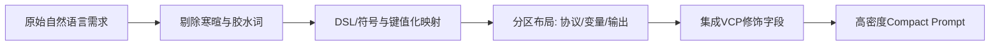

# 省 Token 的紧凑布局提示词设计指南

在构建生产级大模型应用、多 Agent 协作系统及自动化工作流时，提示词（Prompt）不仅是交互指令，更是直接影响 **推理延迟（Latency）**、**API 成本（Cost）** 以及 **模型注意力聚焦度（Attention Concentration）** 的核心资产。

许多开发者习惯用大段自然语言与对话套话书写提示词，导致上下文迅速膨胀、Token 浪费严重，且极易引发“中间丢失（Lost-in-the-middle）”与规则稀释问题。本指南将系统拆解如何利用**紧凑布局（Compact Layout）**设计高密度、低消耗且高遵循度的提示词。

---

## 1. 为什么紧凑布局既省 Token 又能提高性能？

### 1.1 注意力衰减与“信噪比”

自注意力机制在长上下文中具有典型的二次方或全局稀疏分布特性。当 Prompt 充斥无意义的连接词、客套话与冗余解释时，有效指令的注意力权重被严重稀释：

$$
\text{AttentionWeight}(K_{\text{instruction}}) \propto \frac{\exp(Q \cdot K_{\text{instruction}} / \sqrt{d})}{\sum_{i \in \text{Noise}} \exp(Q \cdot K_i / \sqrt{d}) + \sum \exp(\dots)}
$$

消除噪音文本后，模型的注意力和参数激活能够直接聚焦在约束、Schema 和变量本身，不仅显著降低首字延迟（TTFT），更提升了指令依从率（Instruction Following Rate）。

### 1.2 压缩比与收益

$$
\text{Compression Ratio } R = 1 - \frac{\text{Tokens}_{\text{compact}}}{\text{Tokens}_{\text{verbose}}}
$$

实践表明，在结构化任务中，紧凑布局通常可实现 **40% ~ 70%** 的 Token 缩减，而复杂指令执行准确率反而提升 15% 以上。

---

## 2. 紧凑布局提示词处理流程



---

## 3. 紧凑布局的四大核心原则

### 原则一：消除自然语言“胶水词”，转向键值（KV）与紧凑标记

避免使用完整主谓宾语句表述硬性约束。

| 冗长松散表达（消耗大、注意力散） | 紧凑高密度表达（低消耗、强约束） |
| --- | --- |
| "请你务必记住，无论如何不要输出任何解释，直接输出JSON数据即可。" | `Output: ONLY raw JSON. No chatter/markdown wrap.` |
| "如果遇到用户提供的参数不完整的情况，请你主动向用户询问缺失的参数。" | `OnMissingParam: AskUser(missing_keys)` |
| "你是一个有着十年经验的专业资深全栈工程师，擅长TypeScript和React..." | `Role: Senior Full-stack (TS/React/Node)` |

### 原则二：区块隔离与符号定界（Delimiters）

使用简洁的单行符号标记不同信息层，使模型快速建立上下文逻辑图谱：

- `---` 或 `###`：划分逻辑域（Context / Rules / Schema / Input）
- 列表符号 `-`：陈述并行规约
- `Key: Value`：单行高信息密度定义

### 原则三：利用数据模式（Schema）代替长篇举例

不要用大量的 Few-Shot 对话来教模型如何输出某种格式，直接定义最小完整 Schema：

```typescript
// 紧凑模式声明
type Result = {
  id: string; // 唯一标识
  status: 0 | 1; // 0=失败, 1=成功
  tags: string[]; // 分类标签, <=3项
};
```

### 原则四：利用 VCP 协议高级修饰符降低会话回灌

在 VCP（Virtual Context Protocol）体系下，善用协议层的全局修饰字段，能够从架构层面削减多轮交互中的冗余 Token：

- `archery: 'no_reply'`：无回执流，静默执行不中断输出，避免空确认消耗上下文。
- `ink: 'mark_history'`：历史按需持久化，避免将历史检索块长篇反复粘贴在 Prompt 中。
- `river: 'last:3'`：精准截断上下文滑动窗口，仅注入最近 3 轮必要交互。

---

## 4. 典型重构实战：松散 vs 紧凑

### 4.1 改造前：典型 Verbose 提示词（约 420 Tokens）

```text
你好！你是一个非常聪明和严谨的敏捷开发管理助手。
现在我需要你帮助我分析开发任务。当你收到任务描述的时候，请你仔细阅读它，并且帮我拆解成详细的子任务。
在拆解的时候，请你遵守以下规则：
第一点，每一个子任务都要包含名称、耗时预估（单位是小时），以及这个任务的执行优先级，优先级分为高、中、低三个档次。
第二点，如果发现任务描述不够清楚或者缺少必要技术栈说明，请不要随便猜测，要在结果里给出一个需要澄清的问题清单。
第三点，返回的时候千万不要带问候语，也不要说“好的我来帮你做”之类的话，直接按照以下格式给我输出一个列表，列表里每个子任务占一行。
请务必保证输出格式干净清晰，符合工程要求。谢谢你！
```

### 4.2 改造后：紧凑布局提示词（仅 98 Tokens，节省 76%）

```text
Role: Agile Task Planner
Input: Task description & context

Rules:
- Break input into atomic subtasks.
- If info ambiguous/lacking stack: append `Clarifications: [questions]`.
- Output: strictly TSV format, no preamble/postscript.

Format:
| ID | Subtask | Est(h) | Priority(H/M/L) |
Clarifications: <None | list>
```

**效果对比：**
- **Token 消耗**：420 $\to$ 98（直降 76%）
- **边界 case 响应**：紧凑格式清晰定义了 `Clarifications: <None | list>`，模型几乎不再出现自作主张猜测参数的漂移现象。

---

## 5. VCP 工具调用的紧凑布局范例

在调用 VCP 工具（如 `ProjectForge`）执行工程级操作时，紧凑布局能够保证多参数无歧义传递：

```text
<<<[TOOL_REQUEST]>>>
maid:「始」vcp-core「末」,
tool_name:「始」ProjectForge「末」,
command:「始」EditCode「末」,
content:「始ESCAPE」
projectId: vcp-portal
path: src/config.ts
reason: optimize timeout
target1: timeout: 5000
replace1: timeout: 2000
<<<[END_TOOL_REQUEST]>>>
```

**紧凑要点：**
1. 避免在 content 内部附加多余自然语言礼貌说明。
2. 同一文件修改合并为 `target1/replace1`, `target2/replace2` 批处理，避免发起多次往返调用。
3. 对代码块修改采用“首行 + `...` + 尾行”锚定，无需复制完整无关上下文。

---

## 6. 紧凑提示词编写速查清单

- [ ] **是否删除了问候语与尾部客套**（如“你好”、“请帮我”、“期待你的回答”）？
- [ ] **否定指令是否已收敛**（将“请不要做A，也不要做B，千万不要C”归纳为 `Strict: No A/B/C`）？
- [ ] **格式规范是否结构化**（优先使用简写 DSL、TypeScript Type 或紧凑表格，而非大段描述）？
- [ ] **重复变量是否已抽离**（输入放于末尾 `Input: {{text}}`，指令逻辑前置，让 KV Cache 充分命中）？
- [ ] **是否善用工程修饰字段**（如通过 `river` 截断上下文、`archery` 消除无意义确认）？

---

## 总结

编写提示词不是写散文，而是为认知引擎编写高执行力的**执行规范（Spec）**。通过**结构化区块**、**符号化约束**与**协议级控制**，可以用最少量的 Token 获得最高质量、最可复现的输出结果。