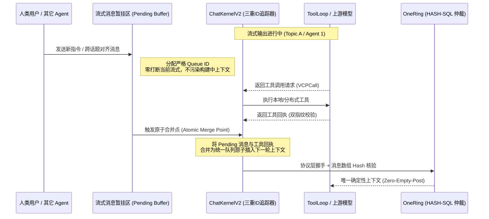
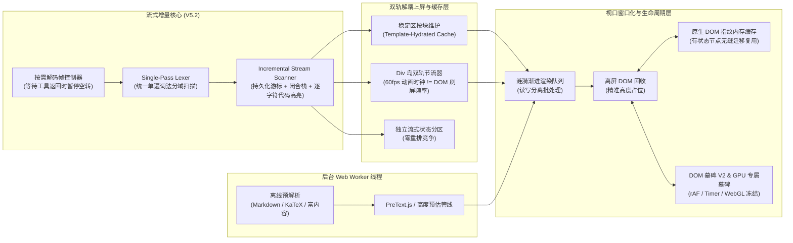

# 单窗口内的终极解耦：VCP AI-Native 异步追踪超级管线与原生流式渲染框架

> **核心工程事实**：在传统的 Web / Electron 对话客户端中，“单流阻塞、跨话题串流、长文越吐越卡、富动画内存泄漏、工具调用竞态丢消息”几乎被视为浏览器单线程模型的宿命。VCP 在 **VChat 单窗口应用**内，历时近两年、历经五代渲染器与两代对话内核重构，从工程底层彻底攻克了**高并发、全异步、抗竞态、流式追踪与 DOM/GPU 渲染的终极解耦**——将多 Agent 工业级群体作战与 `LCP 0.12s / CLS 0.00 / INP 0ms` 的物理级流畅度同时落地为生产现实。

---

## 先动手：一封消息的现场

**[进入 VChat 架构剧场 →](/vchat-theater.html#theater)**

跟随一封武汉天气简报：先看内核如何把消息交给正确的话题，再看渲染器如何把分片变成一个能点击、能迁移的天气岛。每幕都可自动播放、逐拍推进或重演。

| 幕 | 到实验台试什么 | 对应章节 |
| :--- | :--- | :--- |
| [01 · 并发路由](/vchat-theater.html#address) | 切到审稿再注入新分片；确认后台天气流照常计数，旧代次分片被拒收。 | §2.1–2.2 |
| [02 · 暂挂合流](/vchat-theater.html#mailbox) | 先放入人类与 Agent 的插话，再送达工具回执；观察暂挂队列何时转入下一轮。 | §2.3 |
| [03 · 增量分域](/vchat-theater.html#cursor) | 推进正文、代码与交互岛分片；在等待工具时检查游标是否停留原位。 | §3.1–3.2 |
| [04 · 双轨时钟](/vchat-theater.html#clocks) | 先点天气卡，再逐段提交结构；对照动画、提交次数和卡片读数。 | §3.2 |
| [05 · 离屏迁移](/vchat-theater.html#viewport) | 改变读数，再移出、返回或迁移卡片；检查同一原生节点的状态是否保留。 | §3.4 |
| [06 · 输入隔离](/vchat-theater.html#boundary) | 逐层检查固定文本样本，对照词法域、回执归属与宿主能力边界。 | §3.5、零信任输入防线 |

实验台使用浏览器内的教学模型，不连接真实会话、不执行样本文本。页面计数和波形不是生产追踪、性能基准或安全证明。

---

## 一、 架构演进全景：两条主线的合流（2025.06 — 2026.11）

VCP 的前端与全链路交互架构并非在传统聊天框上“打补丁”，而是沿着**「异步对话与追踪管线」**与**「原生流式渲染框架」**两条主线并行演进、最终在单窗口内完成契约合流：

| 演进阶段 | 时间跨度 | 异步对话与追踪管线（Chat & Pipeline） | 原生流式渲染框架（Streaming Renderer） | 核心突破 |
| :--- | :--- | :--- | :--- | :--- |
| **第一代：原生奠基** | 2025.06 — 2026.04 | VChat 落地、超栈追踪协议 1.0/2.0、心流锁 V1、中央消息处理器解耦（Socket 独立追踪 + Promise 容器）、IPC 动态加载与 Preload 工厂化鉴权 | Rust 差分渲染探索、**DOM 墓碑暂存 V1**（2026.01）、**PreText.js** 微神经网络布局拟合（2026.04）、Stable/Stream AST 滑动窗口 | 打破“重刷全屏”与“离开即销毁”的传统网页模式；内存下降 70%，CPU 下降 60% |
| **第二代：内核拆分与真源确立** | 2026.06 — 2026.08 | **OneRing**（400 行纯 HASH-SQL 分布式事实仲裁）、**VCPToolRecord** 全运行时入库、**心流锁 V2**（单 Agent 独立后台并发）、**VCPAgentChatCore + Chat Kernel V1**、三类竞态一致性检查 | **V3 架构**（涟漪渲染引擎、Tombstone V2 事件唤醒、Worker 化解析、ScopedCSS 防火墙） $\to$ **V4 架构**（语义级 Div 岛识别、极端内容防御、非整数 DPI 滚动重构） | 真源（History）、运行态（Kernel）与视图投影（Surface）首次实现物理边界拆分；支持多话题前后台并行流式推进 |
| **第三代：群体协同与多维加速** | 2026.09 — 2026.10 | **GroupChatEngine 2.0**（级联中止、流式插队、Jev 扩散网络发言裁决）、VChat 工作台线程控制台、工具双指纹回执沙箱、上下文 Hash 前后端握手 | **Pixi V8 流式接入 + GPU 专属墓碑冻结**、统一全局磨砂（单次 Blur 缓冲）、**原生 DOM 指纹内存缓存**（V图表基建）、Pele.js 流式图表、按需渐进卡片加载 | 桌面端大型话题冷启动压至 **275MB RAM**，基准跑分达到 **LCP 0.12s / CLS 0.00 / INP 0ms** |
| **第四代：终极解耦与工业闭环** | 2026.11 | **ChatKernelV2 + TopicSponsorV2**（三重 ID 逐 Chunk 追踪 + **流式消息暂挂区** + ToolLoop 合并注入）、心流锁与群聊全量并轨、`/v1/interrupt` 级联中止对齐、**Authority-Only** 事务化、**V通讯**打通前后端 | **V5 / V5.2 架构**（单遍词法分域、流式增量状态机、**Div 岛双轨解耦节流**、模板化缓存、Worker 离线预解析、**离屏 DOM 回收复用有状态原生节点**、等待工具暂停解码、逐字符代码高亮状态机） | 单窗口内实现**真·单流/多流完全异步**与**零空转、零重排、有状态复用的工业级流式渲染** |

---

## 二、 AI-Native 多线程异步追踪超级管线

传统 AI 客户端的致命瓶颈在于“单线程串行假设”：同一时间只能有一个 Agent 说话，流式输出时用户不能发新消息（否则要么强制打断产生残缺历史，要么插队污染推理上下文），切换话题容易丢失正在等待工具返回的状态，多 Agent 协作则极易引发历史文件并发覆盖与死锁。

VCP 通过 **ChatKernelV2 + TopicSponsorV2 + OneRing + V通讯**，构建了一条贯通前后端的 AI-Native 异步追踪超级管线。

### 2.1 真源与投影彻底分离（Authority-Only 架构）

在 V5 与 ChatKernelV2 架构中，系统彻底废除了“DOM 即状态、渲染器直接写历史”的脆弱模式，确立了严格的 **Authority-Only（唯一权威真源）** 原则：

1. **持久化历史真源（Authoritative History）**：所有本地历史修改均通过**原子化事务入口**合并提交，杜绝并发写盘导致的旧快照盲写覆盖。上传/删除附件改为基于最新持久化状态的原子增量修改，不会覆盖并发回复，也不会将流式临时占位误写入历史文件。
2. **界面实时投影（Live View Projection）**：正在流式输出的内容、思考中占位、工具等待半成品、待发送队列均仅存在于运行态投影中，不污染正式历史。
3. **话题投影解耦（V5.2）**：话题导出与摘要生成不再从页面 DOM 反向提取文本，而是直接由独立的话题投影模块提供标准数据，使 UI 渲染与数据消费彻底解耦。
4. **多 Surface 独立运行**：主聊天窗口、独立聊天窗口、VoiceChat、辅助窗口均持有各自独立的流式消费者与 Surface 生命周期，互不隐式共享当前助手或话题投影状态；销毁后迟到的异步结果会被直接拒绝。

### 2.2 三重 ID 鉴权逐 Chunk 消息追踪器（Triple-ID Chunk Tracker）

当单窗口内同时有多个 Agent 在不同话题、不同群聊、不同后台心流中高速吐字时，如何保证每一个字节的流式分片（Chunk）绝不串流、绝不漂移？

ChatKernelV2 确立了以 **`(TopicID, AgentID, MessageID)`** 为核心的**三重 ID 鉴权流形**：

- **物理级因果对齐**：每一个 Chunk 从生成、网络传输、内核调度到最终挂载至目标 Surface，全程携带三重身份坐标与请求代次（Generation / Revision）。
- **防伪与迟到拦截**：重试请求或分支切换会递增代次；旧请求产生的迟到文本、迟到结束事件或异步工具回执在比对代次与三重 ID 失败后会被静默丢弃，彻底消除跨话题串流与内容漂移。
- **流式上下文差分更新（Streaming Context Delta）**：即使在模型高速流式吐字的同时进行话题编辑、历史修正或分支操作，系统也不再粗暴重刷整段上下文，而是通过差分补丁（Delta Patching）精准更新受影响节点，界面纹丝不动、绝不闪烁。

### 2.3 流式消息暂挂区（Message Pending Buffer）与零空 POST 管线

这是实现**真·单流式 / 多流式完全异步**的决定性创新。

1. **流式期间零打断安全暂挂**：任意流式推进期间，人类用户的实时打字纠偏，或其它 Agent 发来的前端点对点回复，均自动进入**流式消息暂挂区**，并分配严格的 **`Queue ID`** 进行全生命周期历史追踪（History Trace）。
2. **ToolLoop 原子合并插入**：在工具调用循环（ToolLoop）中，暂挂队列内的消息会在当前轮次工具执行完毕、回执回填的瞬间，与工具结果**合并为统一队列原子插入**下一轮推理上下文，让模型在下一步思考时一次性获得最完整的环境事实。
3. **`/v1/interrupt` 级联中止对齐与 Zero-Empty-Post 管线**：当长程推理或深层工具链触发级联中止时，中止信号与后续事件平滑进入暂挂队列有序聚合，彻底杜绝因异步时序竞态导致的上游空 Payload POST 请求，显著降低无效网络与模型算力开销。
4. **极端竞态边界兜底**：即便在极端网络波动、或用户直接在本地磁盘手动编辑 `history` 文件的场景下，暂挂队列写入仍具备边界自愈能力，防止消息重复、丢失或错位。

### 2.4 心流锁 V2、GroupChatEngine 2.0 与多 Agent 工业级群体作战

在 2026 年 11 月 10 日的契约收束中，**前端心流锁（Flow-Lock V2）**与 **Jev 智能群聊模式**全面并入 ChatKernelV2 统一内核队列契约，使单窗口具备了支撑“多 Agent 工业级协同作战”的能力：

- **心流锁 V2（独立 Agent 并发态）**：从早期全局共享锁演进为面向单个 Agent 的独立状态机，前后端共用同一套心流锁 Core。多个 Agent 可各自独立创建前端专属话题并进入独立心流锁，在后台并发推进长程任务（如 V工程代码施工），暂时隔绝群聊打扰，同时仍可通过 V通讯保持必要联络。
- **GroupChatEngine 2.0 异步群聊调度**：支持群聊级联队列中止、流式异步群聊与用户动态插队、瀑布流选择器并发优化，以及基于 **Jev 扩散神经网络**的动态发言裁决（智能决定下一位发言者、插队时机与话题启停），并配备多 `history` 之间的 `AgentID` / `MessageID` 异步交叉验证。
- **工业级全景协同闭环**：
  > **开会拍板 $\to$ 领命立项 $\to$ 独自心流施工 $\to$ 暂挂跨话题对齐 $\to$ 返场验收**
  > - 人类与多个 AI 团队可并发开启 2～3 个会议室，秘书 Agent 跨话题穿梭传递决议；
  > - 施工 Agent 团队各自在独立心流话题内闭关施工，期间通过跨话题互挂 **Pending Messages** 对齐接口与进度，互不阻塞各自推理心流；
  > - **人类上帝视角无摩擦介入**：人类可随时切入任意施工话题巡视并打字纠偏，借助暂挂区机制实现“不断流、不污染”的动态共智；
  > - 完工后各 Agent 自动退出心流锁，主动携交付报告返回主会议室汇报验收。

### 2.5 端云一体事实仲裁与全域通讯底座

单窗口的异步解耦不仅局限于前端内存，而是与后端分布式基础设施形成了严密的端到端闭环：

- **OneRing 统一事实时间线**：仅用约 **400 行纯 HASH-SQL 逻辑门**实现的“无状态、无信任、分布式一致仲裁机”。无需依赖前端提交复杂时间轴，即可对来自私聊、群聊、信箱、移动端及不同窗口的消息进行来源标记、编辑同步、分支合并点识别与唯一真相上下文构建；配合前后端**消息数组内容指纹（Hash）握手核验**，确保两端上下文绝对一致。
- **V通讯（V-Comm）全链路打通**：整合 AgentAssistant（AA）总线、TopicSponsor 与 TopicMemo，让后端无头 AA 总线与前端 VChat 共用一套消息与任务分发规则（内置统一心流锁 V2）。支持显式指定发起消息节点、精准投递至目标话题/消息节点、携带上下文/记忆/RiverMemo 场/文件链路，实现诸如 **「前端群聊选中楼层送审 $\to$ 后端 Agent 转发至前端单聊 $\to$ 审查结果带回原群 @发起人」** 的无缝跨端接力。
- **VCPToolRecord 全运行时资产化**：每一次同步、异步、系统或人类发起的工具调用均分配唯一 ID，完整记录从调用、审核、执行、进度到结束的全生命周期，并在工作台与通知栏实时可视。

### 2.6 工业级并发竞态防御矩阵

为确保这套高并发异步系统在长期运行中绝不“假死”或“撕裂”，ChatKernel 构建了多层防御护栏：

| 防御层级 | 核心机制 | 解决的工程痛点 |
| :--- | :--- | :--- |
| **流式一致性三检** | ① 状态投影一致性检查 ② 涟漪渐进渲染队列序列化检查 ③ 流式状态跨域一致化检查 + 流式 ID/渲染任务 ID 交互校验 | 阻止旧任务越过新任务写入 DOM，杜绝话题切换、窗口迁移与迟到事件导致的状态分叉与渲染串线 |
| **死锁与租约自愈** | 自动压缩、工具返回中继与心流锁在取消/异常/流提前结束时的**幂等租约归还**；移除中继确认中 3 秒固定阻塞；CDS 自检租约事务验证 | 彻底根治 Agent 心流状态永久挂起、自检线程与超时请求互锁 |
| **文件同步与配置 WAL** | 发送事务、思考占位与并发流受文件同步保护，事务后自动补偿；**系统配置写入代际桥**（JSON 型 WAL 预写日志分块落盘，按代际合并主配置）；`Revision Token` 世代序号防旧保存覆盖 | 防止外部文件变更误删刚发送的消息；杜绝超高频并发刷写引发的配置文件竞争丢失 |

---

## 三、 原生流式渲染框架 V5.2：终极解耦的工业级渲染管线

如果说 ChatKernelV2 解决了“高并发数据流怎么不乱”，那么历经 V1 $\to$ V3 $\to$ V4 $\to$ V5 $\to$ V5.2 五代演进的 **VCPMessageRenderer**，则解决了“海量复杂富内容在单窗口里怎么丝滑上屏且永不卡顿”。

### 3.1 从 $O(n^2)$ 到 $O(n)$ 的词法与增量状态机革命

传统 Markdown 渲染器在流式输出时，每收到一个 Token 就对整条消息重新运行一遍正则表达式与 Markdown 解析器，计算复杂度呈 $O(n^2)$ 增长，长代码或长对话必然“越吐越卡”。V5 / V5.2 从根基上重写了解析管线：

1. **统一单遍词法分域扫描器（Single-Pass Lexer）**：
   - 彻底废除过去二十余步全量正则流水线，**一次线性遍历**即可精准切分：工具批次、工具结果、思维链（适配 Gemini 4 边输出边思考）、代码围栏与行内代码、桌面推送、HTML 动画岛和普通 Markdown 正文。
   - **严格域隔离**：表情修正、中文去缩进归一化、公式保护等正文处理仅对普通文本域生效，严格隔离代码块、工具参数与内嵌脚本（修复脚本中空行、比较运算符、反引号模板字符串被误解析的顽疾）。
2. **流式增量状态机（Incremental Stream Scanner）**：
   - 运行态持久化词法扫描游标与闭合栈状态。新 Chunk 到达时，**仅增量解析新增片段与未闭合尾区**，稳定区不再重扫。
   - **稳定区按内容块独立维护（V5.2）**：将块级更新与流式尾部推进彻底分开，动画和富内容保留在各自的 DOM 稳定区内，后续文本到达时无需反复解析已稳定区块。
3. **代码块逐字符状态机高亮（V5.2）**：
   - 专用状态机记录代码块尾部的语法解析状态。新字符到达时，直接沿用上一字符遗留状态，实现纯增量 $O(n)$ 逐字符显示与语法高亮，不再依赖逐行回扫。
4. **模块化上下文样式复用（V5.2）**：
   - 消息内嵌 CSS 按稳定区与尾区分别提取缓存，且样式缓存不再将整组样式视为不可拆分整体——即使只有部分样式相同，也可按模块复用解析结果。

### 3.2 按需解码与 Div 岛双轨解耦节流

AI 在单条消息中不仅输出纯文本，还会流式生成 Three.js、Pixi.js、Anime.js、Canvas 甚至复杂交互网页（Div 岛）。若放任重型 DOM 随流式高频重排，60fps 动画将瞬间掉帧崩溃。

1. **等待工具返回时暂停解码（V5.2 按需帧调度）**：
   - 流式帧控制器独立调度解码帧。当 Agent 正在等待外部工具返回、没有待处理数据块时，解码器自动暂停，新数据到达后瞬时唤醒，彻底消灭等待期的逐帧空转。
2. **Div 岛动画帧与渲染帧双轨解耦（Nested-Island Throttling）**：
   - 依托单遍词法分域的 `div` 岛嵌套识别器（对非规范/未闭合标签具备语义级容错，且严格隔离代码块与工具中的 `div` 字面量），一旦进入交互/动画岛域，自动切换至**双轨解耦态**——**不改变 60fps 动画时钟逻辑，同时将重型 DOM 上屏节流降频**。
   - **三级稳态调度策略**：
     - **嵌套最小子 `div` 闭合即刷**：按完整结构块逐块上屏，拒绝半成品标签引发剧烈布局抖动；
     - **`<script>` 中间态静默节流**：脚本尚未闭合时静默累积，待段级脚本闭合就绪后统一交由受控沙箱激活；
     - **超长最小子 `div` 匀速节流**：对超长单块实施 **0.65 秒匀速节流上屏**，兼顾复杂交互岛的流式呼吸感与极低重排开销。
3. **流式状态标识独立分区（V5.2）**：
   - 流式光标/状态标识动画交由独立分区管理，与正文内容渲染分离，消除二者同时更新时的时序竞争与不必要重排。

### 3.3 后台离线预解析、PreText 布局与涟漪渐进引擎

面对动辄数百条富文本、包含海量代码与公式的历史长话题，V5 将繁重计算彻底逐出浏览器主线程：

- **Web Worker 离线预解析管线**：将 Markdown 编译、KaTeX 公式渲染及富内容预处理迁入后台 Worker 线程并行执行；主线程仅负责轻量化 DOM 挂载与事件委托绑定，大幅提升开屏与大话题切换速度。
- **PreText.js 布局拟合与高度预估**：引入基于微型神经网络的文本布局拟合方案，结合后台高度预估管线，在真实 DOM 挂载前即预锁死布局尺寸，直接促成 **`CLS 0.00`（零累积布局偏移）**。
- **涟漪渐进渲染引擎（Ripple Progressive Rendering）**：在可视区域外按距离与内部动画等级建立多级缓冲队列，优先渲染布局尺寸与基础文本而非全量富样式；工具调用与结果卡片在加载历史时默认不预先载入内部冗余长文本，仅在用户展开时按需渐进加载，将排版重绘压力降低数百倍。
- **模板化 HTML 渲染缓存（Template-Hydrated Cache）**：全量覆盖工具请求、工具结果、原子工具批次、HTML 交互岛与短消息；内部采用“HTML 模板 + 工具数据描述 + 轻量指纹校验”结构，切回历史话题时跳过 Markdown 重解析，直接毫秒级还原交互。

### 3.4 视口窗口化、离屏回收与有状态 DOM 复用

针对 500+ 条消息、内含数十个 3D/Canvas/图表动画的超长会话，VCP 构建了独一无二的**三层内存与 GPU 生命周期治理体系**：

1. **视口窗口化与离屏 DOM 回收（Offscreen DOM Eviction）**：
   - 结合实测高度缓存，当消息滚离当前视口较远区域时，自动卸载其重型 DOM 子树，仅保留精确高度占位，维持极低 DOM 节点数与稳定滚动条。
2. **复用原生 DOM 指纹内存缓存（有状态节点无损迁移）**：
   - 复用了最初在 V图表（2026-09-18）中落地的**基于源码内容指纹的原生 DOM 内存缓存基建**。
   - 当离屏的动态内容重新滑回视口（或同一图表在上下文多处引用）时，系统并非凭 HTML 模板重新创建节点并重跑动画脚本，而是**直接将驻留在内存中的有状态原生 DOM 节点重新挂载/迁移至当前视口**，其余位置保留高度占位——**交互状态与动画进度 100% 连续保留，且 N 处引用仅占 1 份运行内存**。
3. **DOM 墓碑冻结 V2 & GPU 专属墓碑管线**：
   - **出生即冻结（Born Frozen）**：所有富动画节点在进入用户视线前均处于冻结态，不消耗帧预算。
   - **全维度冻结与事件唤醒**：离开视口时，墓碑 V2 自动暂停隐式与显式动画的 `rAF`、`setTimeout`、`setInterval` 及事件监听（从轮询改为纯事件唤醒）；针对 Pixi V8 / Three.js 等 WebGL/WebGPU 场景，独立的 **GPU 专属墓碑管线**直接冻结其渲染循环、着色器任务与显存纹理活动，重返视口后毫秒级恢复现场，彻底根治长会话显存泄漏与后台空转。

### 3.5 安全边界、渲染沙箱与视觉性能底座

- **动态内容执行沙箱**：彻底告别脆弱的全局 `window` 补丁，改为基于作用域隔离与受控宿主环境运行 AI 生成的脚本与动画；所有 Three.js、Pixi.js、Anime.js、Canvas 上下文与定时器均绑定至消息专属生命周期控制器，销毁即自动回收，根治跨消息错绑与停帧崩溃。
- **双指纹工具回执沙箱**：后端对工具回执实施双重界定符指纹封装，前端经双指纹严格握手验证后装入独立沙箱容器渲染，从物理层面阻断异常返回语法导致主解析器雪崩熔断或函数逃逸。
- **ScopedCSS 样式防火墙**：仅对需要防御的块级元素定向隔离，极端 CSS 污染自动重定向至所属气泡，绝不泄露至聊天主界面。
- **统一全局磨砂渲染 & 算力动态倾斜**：摒弃单卡片独立 `backdrop-filter` 重复采样，改为单次全局 Blur 缓冲纹理 + 动态视口坐标采样；在 V工程高强度代码施工期间，自动无感禁用局部磨砂特效，将 GPU 合成算力全额倾斜至数千 KB 代码的实时流式高亮。
- **高性能流式图表引擎 Pele.js**：全量替代 Mermaid.js，支持流式逐帧增量生成、响应式自适应与智能框体内换行，渲染性能提升 **100～500 倍**，内存/显存占用下降 **60 倍**。

### 3.6 零重排体验细节与“反生硬”微交互

- **非整数 DPI 缩放底层修复**：收敛 Windows 非 100% 显示缩放下的亚像素尺寸计算误差，彻底消除滚动过程中触发的整窗全局重排（Layout Thrashing）。
- **读写分离批处理与监听裁剪**：视口优化器严格遵循读写分离批处理；移除全子树 `MutationObserver` 变动监听，空闲长历史下不再逐条 DOM 查询判定发送按钮状态。
- **意图驱动自动滚动**：将滚动跟踪器从“是否正在流式输出”的布尔条件中彻底解耦，改为由显式状态声明与用户操作意图联合判定——用户上滑查阅历史时绝不被强行拉回，主动回到底部后自然恢复跟随。
- **渐进载入动画（缓和“过快”带来的突兀）**：在完成极致提速后，为界面切换、话题载入与万级侧栏列表引入渐进动画，并非增加等待，而是消除渲染过快带来的视觉生硬感，实现极速响应与自然过渡的统一。

### 4. 零信任输入防线与 0-IPC 物理零逃逸架构（Zero-Trust & Zero-IPC Sandbox）

在 VCP 的安全设计哲学中，真正的威胁从来不是“AI 主动编写恶意代码攻击宿主”，而是来自**两条极其隐蔽的外部投毒链路**：
1. **不可信的工具回执（Untrusted Tool Payloads）**：当 Agent 抓取外部网页、读取陌生代码库或接收外部数据时，工具回执中可能夹带恶意 HTML/JS 载荷或旨在破坏解析器边界的提示词注入。一旦渲染器在还原回执时发生边界误判，内部潜伏的脚本便可能被强行激活。
2. **人类粘贴的“零信任盲点”（Human Copy-Paste Blindspot）**：用户日常从外部网页复制一段包含恶意 XSS 载荷、畸形闭合标签或混淆脚本的代码粘贴进输入框向 AI 提问时，传统前端往往因为“默认信任用户输入”而疏于防御，导致恶意代码在用户气泡渲染或上下文拼接过程中被意外反转义并原地引爆。

为此，VCP 构建了从**词法边界锁死、双指纹隔离到物理断路**的纵深防御闭环：

* **人类输入与上下文的层层反转义防御（Anti-Injection & Strict Escaping）**：
  * 彻底打破“用户气泡天然可信”的假设盲点。所有人类输入的文本与粘贴代码在进入渲染管线与历史真源前，均经过严格的实体编码锁定与词法域隔离，杜绝任何形式的二次反转义还原；
  * 配合 V5 单遍词法分域扫描器与注释/破坏性占位符防火墙，即便用户输入中包含故意制造歧义的未闭合 `
`、`<script>` 或注释伪标签，也会被死死锁在纯文本/代码字面量域内，绝不越界触发 DOM 解析或污染后续上下文结构。
* **双指纹工具回执沙箱（Dual-Fingerprint Tool Receipt Sandbox）**：
  * 工具回执在后端封装阶段即注入**双重界定符指纹**，前端渲染器通过严格指纹握手确定性识别回执边界与批次归属；
  * 所有工具返回块运行在完全独立的沙箱容器中，彻底阻断内部非规范语法引发主消息解析器雪崩熔断，并严防回执内潜伏的脚本借道执行。
* **全链路 0-IPC 物理级零逃逸断路（Zero-IPC Physical Void）**：
  * 作为最后的物理兜底防线，前端流式渲染器、Div 交互岛及所有富媒体容器在运行时**完全不持有任何底层 IPC 句柄或 Node/Rust 宿主引用**；
  * UI 层被严格约束为**纯状态投影层（Pure State Projection）**，即使极端情况下有恶意载荷突破了层层语法沙箱，其执行作用域外围也是一片没有系统 API 暴露的“物理虚空（Void Boundary）”，永远无法越界触碰宿主机文件系统或终端；同时零跨进程序列化的设计也完整保住了单窗口 275MB 内存与 INP 0ms 的极限性能。
---

## 四、 端到端核心工程指标实证

以下核心性能与稳定性指标均来自 VCP 更新日志中记录的真实生产与基准测试数据：

| 维度 | 核心指标 / 实测表现 | 支撑架构模块 |
| :--- | :--- | :--- |
| **桌面端核心性能基准** | **LCP 0.12s** · **CLS 0.00** · **INP 0ms** · 大型话题冷启动内存 **275MB** | V4/V5 流式引擎 + PreText.js + 按需渐进卡片加载 + Electron 44 |
| **流式解析与高亮复杂度** | 文本/AST 流式解析与代码块逐字符高亮均由 **$O(n^2)$ 降至 $O(n)$** | Single-Pass Lexer + Incremental Stream Scanner + 代码尾状态机 |
| **历史演进资源压榨** | 重构后常规聊天 RAM 压降至 200MB 以下；早期大重构即实现 **RAM -70%、CPU -60%** | IPC 动态加载 + 离屏 DOM 回收 + 墓碑冻结 V2 + GPU 专属墓碑 |
| **流式图表渲染跃迁** | 性能提升 **100～500 倍**，内存/显存占用暴降 **60 倍**，支持逐帧流式生成 | Pele.js 替代 Mermaid.js |
| **异步并发与通信确定性** | **零空上游 POST**；移除 3 秒固定中继阻塞；支持 **500+ 条**超长富内容会话零跳动滚动 | ChatKernelV2 + Pending Buffer + `/v1/interrupt` 对齐 + Offscreen Eviction |
| **跨端事实仲裁轻量度** | **约 400 行纯 HASH-SQL 逻辑门**，近乎零 CPU 占用完成多端唯一真相仲裁 | OneRing 分布式一致仲裁机 |

